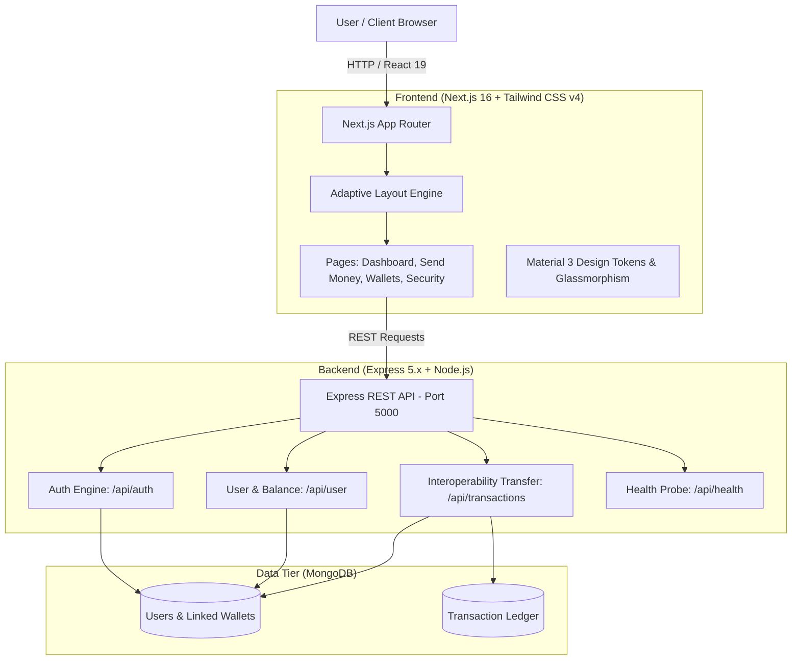
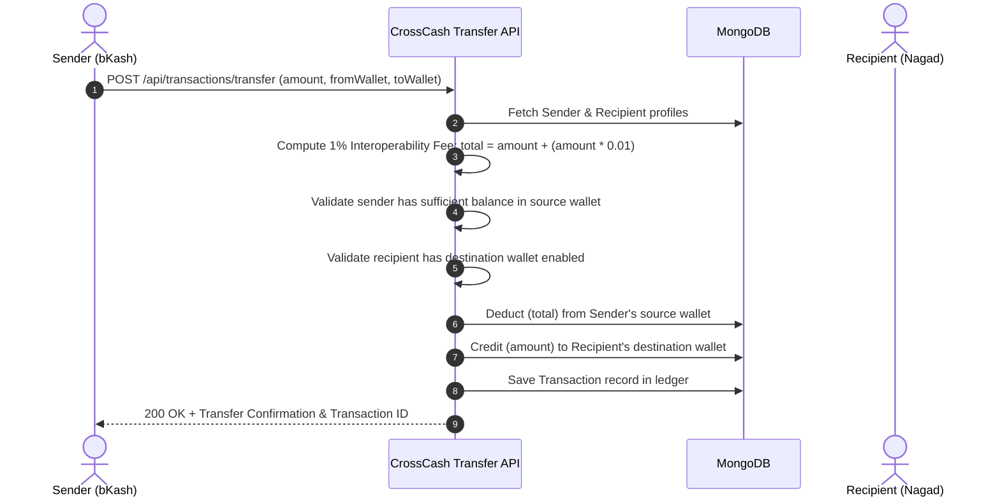

# CrossCash — System Architecture & How the Project Works 💳

## 1. Executive Summary

**CrossCash** is an interoperable fintech portal designed to bridge the fragmented Mobile Financial Services (MFS) ecosystem in Bangladesh (such as **bKash**, **Nagad**, and **Rocket**).

In the current real-world landscape, each MFS provider operates inside a "walled garden": a bKash user cannot directly transfer funds to a Nagad user without third-party bank bridging or cashing out. CrossCash demonstrates how a unified interoperability layer, standardized wallet protocols, and a centralized ledger enable frictionless cross-network money movement with instant settlement and transparent fee structures.

---

## 2. System Architecture



---

## 3. Technology Stack

| Layer | Technologies & Libraries | Key Responsibilities |
| :--- | :--- | :--- |
| **Frontend Framework** | **Next.js 16.3.4** (App Router, Turbopack) | Server & Client components, file-system routing, fast compilation |
| **UI Library** | **React 19.2.8** | Component reactivity, hooks, interactive state |
| **Styling** | **Tailwind CSS v4** + Custom Theme Tokens | Material Design 3 tokens, brand colors (bKash pink, Nagad orange, Rocket purple), responsive utilities |
| **Icons & Typography** | Google Material Symbols + Inter Font | Financial iconography, clean typography hierarchy |
| **Backend Runtime** | **Node.js v24** + **Express v5.2.1** | Lightweight API gateway, middleware processing, JSON parsing |
| **Database ORM** | **Mongoose v9.9.4** | Schema enforcement, document validation, relations |
| **Database** | **MongoDB** (Local or MongoDB Atlas) | Persistent document store for Users, Wallets, and Transactions |

---

## 4. Frontend Design & Screen Flows

The frontend uses an **Adaptive Responsive Architecture**. Instead of forcing one layout to stretch or compress awkwardly, complex screens (such as **Linked Wallets** and **Security Settings**) contain separate desktop and mobile implementations (`desktop/index.tsx` and `mobile/index.tsx`) governed by a responsive wrapper.

### Screen Breakdown

```
frontend/src/app/
├── splash/                 # Splash screen with auto-redirect to login
├── auth/
│   ├── login/              # Phone + PIN authentication screen
│   └── register/           # New account registration
├── page.tsx                # Main Bento-grid Dashboard
├── send-money/             # 5-Step Cross-Wallet Transfer Wizard
│   ├── page.tsx            # Step 1: Recipient phone number & recent contacts
│   ├── amount/             # Step 2: Amount input & real-time 1% fee calculation
│   ├── confirm/            # Step 3: Transaction summary & provider review
│   ├── pin/                # Step 4: Custom virtual PIN pad & biometrics
│   └── success/            # Step 5: Digital receipt with voucher cutout aesthetics
├── linked-wallets/         # Multi-wallet management (bKash, Nagad, Rocket, Bank)
│   ├── mobile/             # Mobile card stack view
│   └── desktop/            # Desktop bento-grid view
├── security-settings/      # Security & Privacy preferences
│   ├── mobile/             # Touch-friendly toggle list
│   └── desktop/            # Two-column device management & limits control
└── transactions/           # Transaction history table with inbound/outbound filter tabs
```

### Key UI Features
1. **Bento-Grid Dashboard**: Displays aggregated total balance, individual MFS wallet balances, quick-send contact bubbles, and recent transfer activities.
2. **5-Step Transfer Wizard**: Provides clear step-by-step progress, prevents user error with live fee calculation (1% interoperability charge), and provides a tactile digital PIN keypad.
3. **Adaptive Component Splitting**: Mobile users get bottom navigation (`BottomNavBar`) and bottom sheet styles; desktop users get fixed sidebar navigation (`Sidebar`) and multi-column grids.

---

## 5. Backend Logic & Interoperability Engine

### 1. Unified Wallet Schema (`models/User.js`)
Each user has an array of linked wallet accounts under their primary CrossCash profile:
```javascript
{
  phone: "01712345678",
  name: "Sadia Rahman",
  pin: "1234",
  wallets: [
    { provider: "bKash", identifier: "01712345678", balance: 8230.50 },
    { provider: "Nagad", identifier: "01998765432", balance: 4219.50 }
  ]
}
```

### 2. Cross-Wallet Transfer Mechanics (`routes/transaction.js`)
When a user initiates a transfer from **Wallet A (e.g. bKash)** to a recipient who receives it in **Wallet B (e.g. Nagad)**:



### 3. API Endpoints Reference

| Method | Endpoint | Description | Sample Payload / Params |
| :--- | :--- | :--- | :--- |
| `GET` | `/api/health` | Service health status check | None |
| `POST` | `/api/auth/register` | Register new user with initial demo wallet | `{ "phone": "017...", "name": "...", "pin": "1234", "provider": "bKash" }` |
| `POST` | `/api/auth/login` | Authenticate by phone number & PIN | `{ "phone": "017...", "pin": "1234" }` |
| `GET` | `/api/user/:userId/balance` | Calculate aggregated balance across all linked wallets | `userId` in URL |
| `POST` | `/api/transactions/transfer` | Execute cross-wallet interoperable transfer | `{ "senderId": "...", "recipientPhone": "...", "fromWalletProvider": "bKash", "toWalletProvider": "Nagad", "amount": 500 }` |
| `GET` | `/api/transactions/:userId` | Retrieve inbound & outbound transaction records | `userId` in URL |

---

## 6. Security & Transaction Safeguards

1. **Transaction Limits**: Daily and single-transaction caps adjustable under Security Settings.
2. **Two-Factor Authentication & Biometrics**: Simulated Face ID / Fingerprint prompt during final authorization.
3. **Graceful Database Offline Handling**: The backend automatically falls back to safe operational mode if a local MongoDB server is not discovered on port 27017, keeping API endpoints responsive while reporting clear diagnostic logs.

---

## 7. How to Run Locally

### Prerequisites
- **Node.js** v18+ (tested on Node v24)
- **npm** v9+
- *(Optional)* **MongoDB** running locally on port `27017` or a MongoDB Atlas URI in `backend/.env`.

### Step 1: Start the Backend Server
```bash
cd backend
npm install
npm start
```
*Backend runs at [http://localhost:5000](http://localhost:5000).*  
Health check: [http://localhost:5000/api/health](http://localhost:5000/api/health).

### Step 2: Start the Frontend Application
```bash
cd frontend
npm install
npm run dev
```
*Frontend runs at [http://localhost:3000](http://localhost:3000).*

---

## 8. Summary of Directory Structure

```
crossCash/
├── backend/
│   ├── models/
│   │   ├── User.js             # Mongoose User & Wallet schema
│   │   └── Transaction.js      # Mongoose Transfer ledger schema
│   ├── routes/
│   │   ├── auth.js             # Registration & Login endpoints
│   │   ├── transaction.js      # Cross-wallet fee & transfer logic
│   │   └── user.js             # Wallet balances & profile endpoint
│   ├── .env                    # Environment variables (PORT, MONGO_URI, JWT_SECRET)
│   ├── index.js                # Express app entry point & route registration
│   └── package.json            # Backend scripts and dependencies
├── frontend/
│   ├── public/                 # Static assets
│   ├── src/
│   │   ├── app/                # Next.js App Router pages
│   │   ├── components/         # Reusable layouts (Sidebar, TopAppBar, BottomNavBar)
│   │   └── globals.css         # Tailwind v4 theme & Material Design 3 tokens
│   ├── next.config.ts          # Next.js configuration
│   ├── package.json            # Frontend scripts and dependencies
│   └── tsconfig.json           # TypeScript configuration
├── HOW_THE_PROJECT_WORKS.md    # This technical guide
└── README.md                   # Quickstart guide
```
